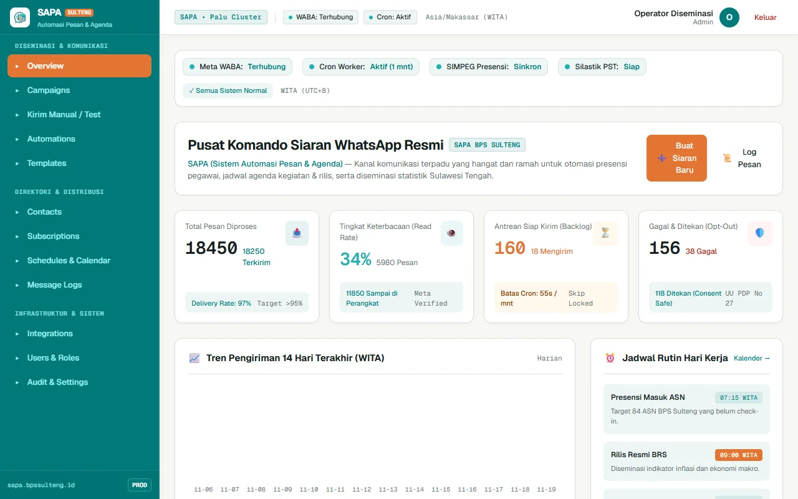

# SAPA BPS Sulteng — WhatsApp Operations Platform

> **Sistem Automasi Pesan & Agenda (SAPA)** — Monorepo platform siaran WhatsApp, penjadwalan cron, dan portal langganan publik via **Meta WhatsApp Cloud API** untuk **BPS Provinsi Sulawesi Tengah**.




### Fitur & Struktur Workspace

- **Campaign & Anti-Spam Throttling** — Siaran terjadwal dengan rate-limit (`msg/sec`), sinkronisasi template Meta WABA, serta pelacakan status `sent / delivered / read`.
- **Automated Reminders & Opt-In** — Cron pengingat presensi pegawai, jadwal rilis BRS/publikasi, dan manajemen consent UU PDP (`DAFTAR / BERHENTI / BANTUAN`).

```text
apps/       # API server (Node.js) & Dashboard Web SPA (Svelte)
db/         # Migrations & seeders PostgreSQL
scripts/    # Worker cron, health check & backup packagers
tests/      # Vitest + Supertest integration & security tests
```

```bash
npm install && npm run migrate
npm run dev         # jalankan API + Svelte web bersamaan
npm run test:all    # unit, contract, security & E2E suites
```
